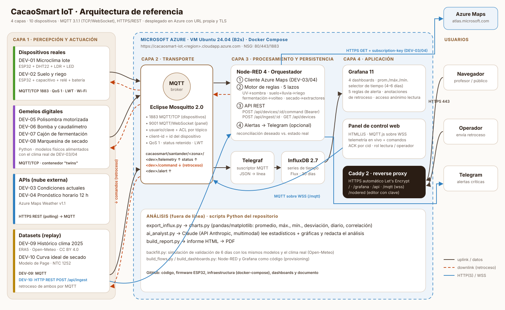

# 🍫 CacaoSmart IoT

**Agricultura de precisión para el cultivo y beneficio de cacao fino de aroma en Santander, Colombia.**
Proyecto final · Internet de las Cosas · *IoT a la medida*

10 dispositivos (2 reales ESP32 · 2 API Azure Maps · 4 gemelos digitales · 2 datasets) → MQTT (Mosquitto) → Node-RED (motor de reglas + API REST) → InfluxDB → Grafana, con **retroceso** (encender, apagar, calibrar, ajustar) desde un panel web propio, la API REST o el motor de reglas automático. Todo desplegado en **Azure** con URL propia y HTTPS.

| | |
|---|---|
| 🌐 Panel de control | `https://<su-dominio>/` |
| 📊 Grafana | `https://<su-dominio>/grafana/` |
| 🔌 API REST | `https://<su-dominio>/api/devices` |
| 📄 Informe | [`docs/Informe_CacaoSmart_IoT.pdf`](docs/Informe_CacaoSmart_IoT.pdf) |



## Dispositivos

| ID | Dispositivo | Tipo | Variables principales | Protocolo | Retroceso |
|----|-------------|------|-----------------------|-----------|-----------|
| DEV-01 | Nodo microclima lote (ESP32 + DHT22 + LDR) | Real | temp, HR, lux, RSSI | MQTT/TCP | CALIBRATE, LED, SET_INTERVAL, POWER, REBOOT |
| DEV-02 | Nodo suelo y riego (ESP32 + capacitivo + relé) | Real | humedad suelo, válvula, batería | MQTT/TCP | RELAY, SET_THRESHOLD, SET_MODE, CALIBRATE |
| DEV-03 | Estación meteo (Azure Maps Current Conditions) | API | temp, sensación, HR, UV, viento, nubosidad, presión, lluvia | HTTPS REST → MQTT | SET_INTERVAL, SET_LOCATION, POLL_NOW, POWER |
| DEV-04 | Pronóstico (Azure Maps Hourly Forecast) | API | prob. lluvia 1/3/12 h, lluvia 12 h, nubosidad | HTTPS REST → MQTT | AHORRO_AGUA, SET_INTERVAL, POLL_NOW |
| DEV-05 | Polisombra motorizada | Gemelo | cierre %, corriente, radiación ext./filtrada | MQTT | SET_SHADE, SET_MODE |
| DEV-06 | Bomba y caudalímetro de goteo | Gemelo | caudal, presión, consumo | MQTT | START/STOP, SET_FLOW, LEAK |
| DEV-07 | Cajón de fermentación | Gemelo | temp masa, pH, horas, volteos | MQTT | VOLTEO, RESET_CYCLE |
| DEV-08 | Marquesina de secado solar | Gemelo | humedad grano, temp/HR interna, extractores, compuertas | MQTT | EXTRACTORES, COMPUERTAS, RESET_BATCH |
| DEV-09 | Histórico clima cosecha 2025 (ERA5) | Dataset | temp, HR, suelo, ET0, lluvia, radiación | MQTT | PAUSE/RESUME, SET_SPEED, INJECT_ANOMALY |
| DEV-10 | Curva ideal de secado (modelo de Page) | Dataset | humedad objetivo, temp óptima, calidad | **HTTP REST** | SET_PROFILE, PAUSE/RESUME |

Todos aceptan además `POWER`, `SET_INTERVAL`, `CALIBRATE`, `RESET_CALIBRATION`, `SET_MODE` y `PING`, y confirman cada orden (ACK) en su tópico `status`.

## Contrato MQTT

```
cacaosmart/santander/<zona>/<dev>/telemetry   ↑ QoS 1  {"ts":"…Z","type":"real","seq":12,"temp_c":24.6,...}
cacaosmart/santander/<zona>/<dev>/status      ↑ retenido: online, power, intervalo, modo, offsets, last_cmd{cid,ok,msg}  (+ LWT online=0)
cacaosmart/santander/<zona>/<dev>/command     ↓ QoS 1  {"cmd":"CALIBRATE","temp_offset":-0.8,"cid":"p1","src":"panel"}
cacaosmart/santander/<zona>/<dev>/alert       ↑ {"rule":"moniliasis","severity":"critical","msg":"…","value":89}
```
Zonas: `lote1` (01, 02, 05, 06) · `clima` (03, 04) · `beneficio` (07, 08) · `historico` (09, 10).

## Motor de reglas (retroceso automático)

| Lazo | Condición | Acción |
|------|-----------|--------|
| 1 · Protección solar | UV (DEV-03) ≥ 8 | Polisombra DEV-05 al 80 % + LED DEV-01 (vuelve a 30 % con UV ≤ 5) |
| 2 · Riego predictivo | Suelo DEV-02 < umbral | Consulta DEV-04: lluvia < 30 % → riego 15 min; 30–65 % → 8 min; > 65 % → inhibido |
| 3 · Calibración remota | Operador | CALIBRATE offset/intervalo en el ESP32 |
| 4 · Fermentación | Masa > 50 °C o 48/96 h | VOLTEO |
| 5 · Secado | Marquesina > 45 °C / < 40 °C / lluvia | Extractores y compuertas |
| Alertas | Moniliasis (HR > 88 % y T > 26 °C, 4 h), sobrecalentamiento > 46 °C, fuga, secado retrasado, offline | MQTT + Grafana + Telegram |

## Ejecutar en local (Docker Desktop)

```bash
cp .env.example .env          # ponga su AZURE_MAPS_KEY; PUBLIC_URL=http://localhost
docker compose --profile emulador up -d --build
```
Panel: http://localhost · Grafana: http://localhost/grafana · Node-RED: http://localhost/nodered

`--profile emulador` levanta una réplica de los ESP32 para probar sin hardware. Para poblar Grafana con 6 días de prueba:
`python analysis/backfill.py --influx` (marcado `source=simulacion`).

## Desplegar en Azure (URL propia + HTTPS)

```bash
az login
DNS=cacaosmart-iot LOC=northcentralus SIZE=Standard_B2as_v2 bash deploy/azure-deploy.sh
ssh azureuser@cacaosmart-iot.northcentralus.cloudapp.azure.com
git clone https://github.com/luisbohorquez15/CacaoSmart-IoT.git cacaosmart-iot && cd cacaosmart-iot
AZURE_MAPS_KEY=<clave> PUBLIC_URL=https://cacaosmart-iot.northcentralus.cloudapp.azure.com bash deploy/setup-vm.sh
```
Caddy obtiene el certificado de Let's Encrypt automáticamente. Luego configure en el firmware de los ESP32 el dominio, la clave `MQTT_DEVICE_PASS` y su Wi-Fi, y cárguelo desde el IDE de Arduino (librerías: PubSubClient, ArduinoJson 7, DHT sensor library).

## Informe con los 6 días reales

Después de ≥ 6 días de captura en la nube:
```bash
python3 analysis/export_influx.py --days 6          # en la VM (o con túnel ssh -L 8086:localhost:8086)
python analysis/charts.py --data analysis/data/real
python analysis/ai_analyst.py                       # análisis con IA (requiere ANTHROPIC_API_KEY)
python docs/build_report.py                         # -> docs/Informe_CacaoSmart_IoT.pdf
```
Edite `docs/informe.config.json` (integrantes, docente, URL, GitHub) antes de generar la versión final.

## Estructura

```
docker-compose.yml        infraestructura completa (8 servicios)
infra/                    mosquitto (conf, ACL), telegraf, caddy, node-red (flows + funciones JS), grafana (dashboards, alertas)
devices/cacaosmart/       núcleo de dispositivo, modelos físicos, gemelos, datasets, emulador ESP32
devices/real/             firmware Arduino de los ESP32 (DEV-01, DEV-02)
devices/datasets/         datasets CSV y script que los construye
web/                      panel de control (HTML/CSS/JS + MQTT.js)
analysis/                 backfill, exportación, gráficas/estadísticos y análisis con IA
scripts/                  generadores de flows de Node-RED y dashboards de Grafana (como código)
deploy/                   Azure CLI + cloud-init + arranque en la VM
docs/                     informe PDF, arquitectura, figuras
```

## Seguridad
Sin acceso anónimo a MQTT; usuarios `device`/`service`/`viewer`/`operador` con ACL por tópico (cada dispositivo sólo publica en sus tópicos); API REST de comandos con token Bearer; editor Node-RED y Grafana admin con clave; HTTPS/WSS en todo el tráfico web; secretos sólo en `.env` (no versionado).

## Créditos de datos
Clima: Azure Maps Weather (Microsoft) · Histórico: ERA5/ERA5-Land vía Open-Meteo (CC BY 4.0).
